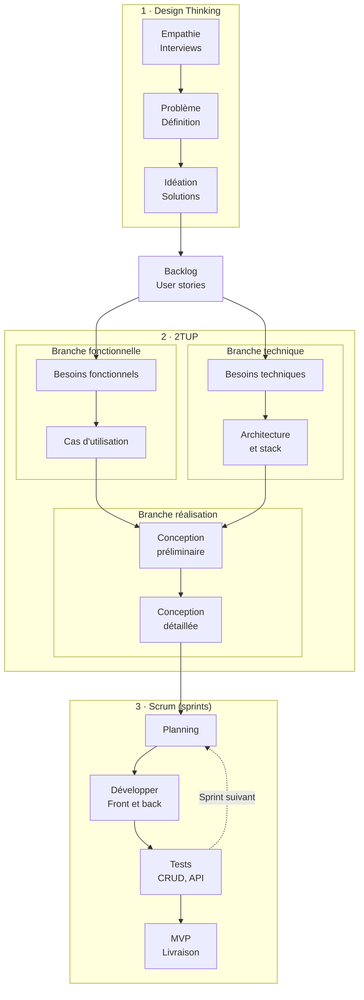

# Flux de travail : Smart Tourism

## Vue d'ensemble

Le projet combine trois approches :
- **Design Thinking** : comprendre les besoins des utilisateurs
- **2TUP** (Two Track Unified Process) : structurer l'analyse et la conception en deux branches, fonctionnelle et technique
- **Scrum** : réaliser et livrer le MVP par sprints

## 1 · Design Thinking

| Étape | Objectif | Livrable |
|---|---|---|
| Empathie | Comprendre les besoins du voyageur et de l'administrateur | Carte d'empathie |
| Problème | Formuler clairement le problème à résoudre | Définition du problème |
| Idéation | Imaginer les solutions et les fonctionnalités | Liste d'idées retenues |
| Backlog | Transformer les besoins validés en user stories priorisées | Product Backlog |

## 2 · 2TUP (processus en Y)

| Branche | Étape | Objectif | Livrable |
|---|---|---|---|
| Fonctionnelle | Besoins fonctionnels | Lister ce que le système doit faire | Branche fonctionnelle |
| Fonctionnelle | Cas d'utilisation | Décrire les interactions des acteurs avec le système | Diagramme de cas d'utilisation |
| Technique | Besoins techniques | Identifier les contraintes techniques et de sécurité | Liste des contraintes |
| Technique | Architecture et stack | Choisir l'architecture et les technologies | Architecture technique |
| Réalisation | Conception préliminaire | Réunir les deux branches : structurer les modules et les données | Diagramme de classes, base de données |
| Réalisation | Conception détaillée | Détailler les écrans et le comportement de chaque module | Maquettes, interfaces |

## 3 · Scrum (sprints)

| Étape | Objectif | Livrable |
|---|---|---|
| Planning | Choisir les user stories du sprint selon la priorité | Sprint Backlog |
| Développer | Réaliser les fonctionnalités (frontend et backend) | Code fonctionnel |
| Tests | Vérifier les opérations CRUD, l'API et l'affichage responsive | Fonctionnalités validées |
| MVP | Livrer la première version de la plateforme | MVP Smart Tourism |

Les étapes Planning, Développer et Tests se répètent à chaque sprint jusqu'à la livraison du MVP.

## Priorités des sprints

1. Destinations, lieux, activités, catégories
2. Favoris, avis et évaluations
3. Voyages et étapes, espace d'administration

## Stack technologique

- **Frontend** · HTML5 · Tailwind CSS · JavaScript Vanilla · Alpine.js · Preline
- **Backend** · PHP 8+ · Laravel
- **Architecture** · MVC
- **Base de données** · MySQL
- **Mobile** · PHP Native · Kotlin
- **Diagrammes** · Mermaid 
